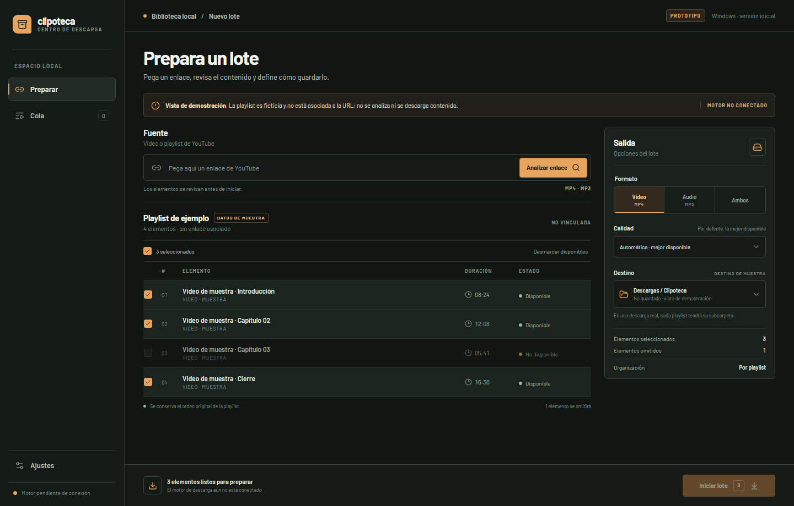

# Clipoteca

Aplicación de escritorio para Windows para preparar y gestionar descargas autorizadas de videos y playlists. El proyecto prioriza la revisión de playlists y el estado de cada elemento.

> **Estado actual:** primera entrega visual. La interfaz funciona con datos de demostración; el análisis real con `yt-dlp` y las descargas todavía no están conectados. No se inicia ninguna descarga desde esta versión.



## Stack

- Python + [pywebview](https://pywebview.flowrl.com/) como ventana de escritorio.
- React + TypeScript + Vite para la interfaz local.
- [yt-dlp](https://github.com/yt-dlp/yt-dlp) previsto como motor de descarga.
- FFmpeg previsto para unir pistas y convertir audio a MP3. Su distribución y avisos de licencia deben revisarse antes de empaquetar.
- La interfaz usa WebView2 en Windows.

## Requisitos de desarrollo

- Windows.
- Python 3.11 o superior.
- Node.js y npm.
- Microsoft Edge WebView2 Runtime para ejecutar la ventana de escritorio.

## Ejecutar la interfaz en el navegador

```powershell
cd frontend
npm install
npm run dev
```

Vite mostrará la dirección local de desarrollo. En esta modalidad, la interfaz es una previsualización y no descarga contenido.

## Ejecutar en la ventana de escritorio

Desde la raíz del repositorio:

```powershell
python -m venv .venv
.\.venv\Scripts\Activate.ps1
pip install -r requirements.txt
cd frontend
npm install
npm run build
cd ..
python main.py
```

Para desarrollo con Vite Hot Module Replacement, ejecuta `npm run dev` dentro de `frontend` en una terminal y, desde otra terminal en la raíz:

```powershell
python main.py --dev
```

## Qué incluye esta primera entrega

- Interfaz oscura en español con dirección de diseño **Media Ingest Workbench**.
- Preparación de lote con muestra de playlist claramente marcada como ficticia.
- Selección de elementos disponibles, selección global, formato, calidad y destino en modo demostración.
- Vista inicial de cola vacía.
- Controles etiquetados y adaptaciones para ventanas más estrechas.
- La acción de inicio permanece deshabilitada hasta que exista un motor de descarga real.

## Siguiente implementación

1. Conectar el puente Python–React y analizar URLs con yt-dlp.
2. Mostrar metadatos y selección real de elementos de playlists.
3. Añadir la cola de descargas con progreso por elemento, cancelación, reintentos y recuperación.
4. Implementar el selector de carpeta y las opciones de salida reales.
5. Validar FFmpeg, licencias, empaquetado e instalador de Windows.

## Alcance responsable

Clipoteca se diseña para contenido que el usuario posee o está autorizado a descargar. No contempla eludir DRM, controles de acceso ni autenticación. El usuario debe respetar los derechos de autor y las condiciones aplicables de las plataformas.
